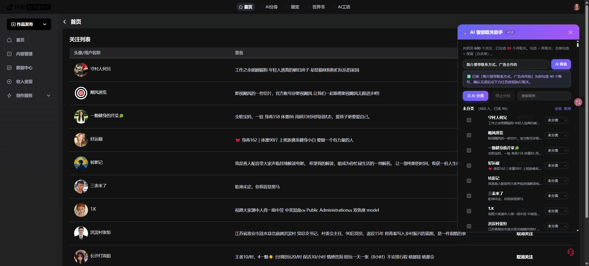

# 🧹 AI 智能取关助手（Chrome 扩展）

抖音 / B站 关注列表 AI 分析插件：一键抓取全部关注 → AI 分类/筛选 → 勾选确认 → 批量取关。**零配置开箱即用**（内置多个实测可用的免费 AI 接口，自动故障转移）。



## 功能

- **全量抓取**：抖音创作者平台接口直翻（600 人约 40 秒）；B站关注列表全量抓取（分组接口失效自动回退）
- **AI 分类**：常看博主 / 可能认识 / 僵尸号 / 营销号 / 不感兴趣，零未分类
- **快捷筛选**（一键预设）：🌶️ 擦边检测、😴 不常看检测、🧩 按领域分组（动态领域标签，按组勾选）
- **自定义筛选**：一句话描述（如"很久不更新 / 广告带货 / 昵称是乱码的"）→ AI 自动勾选
- **批量取关**：勾选即白名单反选，确认弹窗 + 逐个执行 + 成功/失败统计；全程浏览器本地完成
- **稳定性**：20 级 AI 接口故障转移链、45s 超时、429/5xx 自动退避重试、弹窗内「一键修复接口权限」

## 安装

### 方式一：加载源码目录（开发模式，推荐）

1. 下载本仓库，打开 Chrome → `chrome://extensions` → 开启「开发者模式」
2. 「加载已解压的扩展程序」→ 选择本仓库根目录（含 manifest.json）

### 方式二：CRX

`release/AI-Smart-Unfollow-v1.3.3.crx` 需配合同目录 `AI-Smart-Unfollow.pem`（Chrome 出于安全策略不允许直接拖拽安装第三方 CRX，建议用方式一）。

## 使用

1. 打开 [抖音创作者平台关注管理页](https://creator.douyin.com/creator-micro/data/following/following)（抖音 APP 扫码登录）或 B站任意页面
2. 点右侧悬浮球 🧹 → 「① 抓取关注列表」
3. 点快捷筛选按钮、输入自定义描述、或「② AI 分类」
4. 核对勾选结果（可手动增删）→ 红色「确认并取关」

## AI 接口

默认内置并自动故障转移以下**实测可用**接口（弹窗中可手动切换预设）：

| 接口 | 模型 | 备注 |
|---|---|---|
| agnes-ai | 2.5-pro-beta / 3.0-flash / 2.5-flash 等 6 个 | 1.6~2.6s |
| 商汤 SenseNova | deepseek-v4-flash（默认）/ glm-5.2 / 6.8-flash-lite | 主备双 Key |
| AMD Radeon | DeepSeek-V4-Flash / V4.1-Flash / GLM-5.3-Flash / Qwen3.8 系列 / MiMo-V2.6 等 8 个 | 5~15s |
| NVIDIA NIM | z-ai/glm-5.3-flash | 10~12s |
| 点点笔记 | dots3-note-prev | 兜底 |

Key 仅保存在浏览器本地 `chrome.storage.sync`，只用于直连对应接口。

## 隐私与安全

- 抓取的账号数据只发送给你配置的 AI 接口做分类，不经过任何第三方服务器
- ⚠️ 本仓库内置了个人免费接口的 API Key，仓库设为私有；若转为公开请先移除 `background/service-worker.js` 与 `popup/popup.html` 中的 Key

## 目录结构

```
manifest.json          # MV3 清单（host_permissions 覆盖平台与 AI 域名）
background/service-worker.js  # AI 请求转发 + 故障转移 + 设置存储
content/
  bilibili.js          # B站适配器（抓取/取关）
  douyin.js            # 抖音适配器（接口直翻抓取/取关）
  panel.js / panel.css # 悬浮面板（分类/筛选/进度/执行）
popup/                 # 弹窗（设置/预设/权限诊断/连通性测试）
_test/                 # 测试脚本与实测结果（bsk / CDP / 接口扫描）
release/               # 打包好的 CRX + 私钥
```

## 版本

- v1.3.3（面板徽标 v1.4）：20 级 AI 故障转移链、严格实测 19 个模型、CRX 打包
- v1.3.0：擦边/不常看/领域分组三种快捷筛选 + 自定义描述筛选
- v1.2.0：抖音接口直翻全量抓取、真实取关验证
- v1.1.0：修复 B站分组接口失效、AI 接口接入、现代 UI
